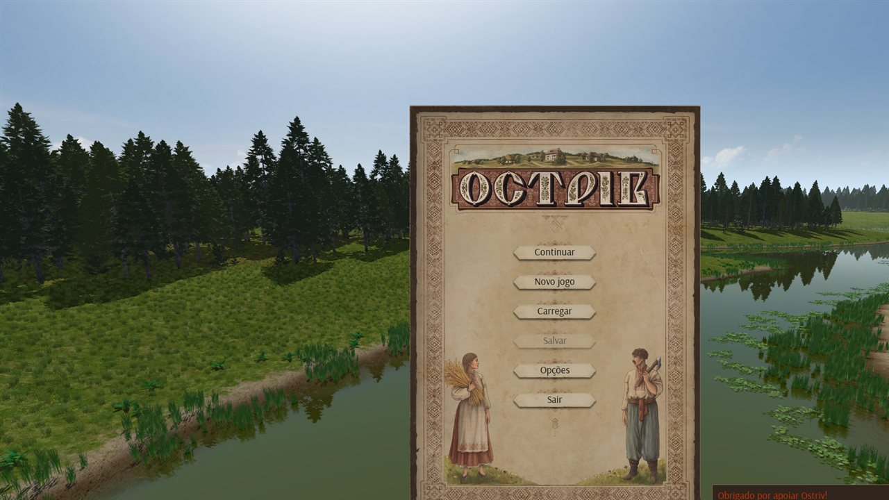

# Ostriv PT-BR

Tradução completa para **Português do Brasil** do jogo [Ostriv](https://ostrivgame.com/) 0.5.9.58.



O projeto é **baseado em patch**: nenhum arquivo do jogo é distribuído. O instalador
aplica um patch ao `ostriv.exe` que você já possui e gera um executável separado
traduzido (`ostriv_ptbr.exe`). O executável original **não é alterado**.

## Recursos

- Menus, botões, painéis de construção, recursos, população, tesouro e comércio.
- Nomes de construções, recursos, animais, árvores, meses e status dos cidadãos.
- Dicas, avisos, mensagens e tutoriais.
- **Ajuda completa**: índice, títulos e artigos (incluindo os textos longos).
- Acentos corretos (a tradução usa o slot Unicode UTF-16 do jogo).
- Jogo bilíngue: **English** e **Português (Brasil)** no menu de idiomas.
- Instalador que localiza o jogo em instalações **Steam**, **GOG** e **portáteis**.

## Requisitos

- Windows.
- Ostriv **0.5.9.58** (Steam, GOG ou versão portátil).
- Uma cópia legítima do jogo.

## Instalação

### Opção 1 — pacote portátil (recomendado)

1. Baixe `Ostriv-PTBR-Portable.zip` (na pasta `dist/` ou na página de releases).
2. Extraia **na pasta raiz do jogo** ou em qualquer pasta.
3. Execute `INSTALAR.bat`.

O instalador:

- procura o `ostriv.exe` em todas as bibliotecas Steam, no registro do GOG, em
  `C:\Games\Ostriv`, `D:\Games\Ostriv` etc. e na pasta atual (incluindo o layout
  `Game\Ostriv`);
- se não encontrar, pede para você selecionar a pasta;
- aplica o patch e cria `ostriv_ptbr.exe`;
- cria o launcher PT-BR quando detecta o loader portátil;
- define o idioma **Português (Brasil)**;
- cria o atalho **Ostriv PT-BR** na área de trabalho.

Na primeira execução o Windows Firewall pode perguntar sobre o `ostriv_ptbr.exe`.
Pode permitir ou cancelar (o jogo funciona offline).

### Opção 2 — aplicar o patch manualmente

```powershell
powershell -ExecutionPolicy Bypass -File dist\Apply-Patch.ps1 `
  -InputExe "C:\Games\Ostriv\Game\Ostriv\ostriv.exe" `
  -OutputExe "C:\Games\Ostriv\Game\Ostriv\ostriv_ptbr.exe" `
  -PatchFile "dist\ostriv_0.5.9.58_ptbr.patch"
```

Depois execute `ostriv_ptbr.exe` (ou crie um atalho).

## Idioma

O jogo fica em português por padrão. Para trocar:

**Opções → Idioma → English / Português (Brasil)**

O idioma fica salvo em `Saved Games\Ostriv\settings.data` e é compartilhado pelos
dois executáveis. Se abrir o `ostriv.exe` original com o idioma em Português, ele
mostrará o texto ucraniano original; selecione **English** para voltar ao inglês.

## Desinstalar

Execute `DESINSTALAR.bat` (na pasta do instalador) ou:

```powershell
powershell -ExecutionPolicy Bypass -File dist\Desinstalar.ps1
```

Isso remove `ostriv_ptbr.exe`, o launcher PT-BR e o atalho, e volta o idioma para
inglês. O `ostriv.exe` original permanece intacto.

## Compatibilidade

A tradução foi gerada para o **Ostriv 0.5.9.58**. O instalador detecta a versão do
executável e avisa se for diferente. Versões mais novas (por exemplo 0.5.9.63)
exigem regerar o patch a partir do novo executável.

O patch verifica o SHA1 do executável original. Se você tiver um build diferente
da mesma versão (por exemplo, GOG), o instalador oferece tentar mesmo assim.

## Limitação conhecida

Alguns rótulos das telas de **Novo jogo** e **Opções** são desenhados pelo motor
por um caminho que só aceita ASCII; nesses poucos rótulos os acentos aparecem sem
diacríticos (ex.: `reinicializacao`). O restante do jogo, incluindo toda a Ajuda,
mostra os acentos corretamente.

## Como funciona

O Ostriv guarda os textos dentro do `ostriv.exe`:

- textos localizados em pares (inglês UTF-8 / ucraniano UTF-16);
- textos de ajuda em blocos UTF-16 separados.

O patch:

1. cria uma seção `.ptbr` no executável com os textos em português;
2. redireciona as referências dos textos localizados para o slot UTF-16 (o mesmo
   usado pelo ucraniano), preservando os acentos;
3. mantém o inglês original intacto no slot UTF-8;
4. traduz também as cópias ucranianas usadas pela Ajuda.

O arquivo `.patch` contém apenas os bytes alterados e a seção `.ptbr` — não contém
o código nem os textos originais do jogo.

## Estrutura do repositório

```
dist/                       instalador, desinstalador e patch
  INSTALAR.bat
  Instalar.ps1
  Apply-Patch.ps1
  ostriv_0.5.9.58_ptbr.patch
  DESINSTALAR.bat
  Desinstalar.ps1
  LEIA-ME.txt
data/
  translations/             traduções por lote (pt-BR)
  pt_br.json                tradução final (id -> pt-BR)
  overrides.json            ajustes de tamanho
  patch_plan.json           plano de patch (offsets + textos pt-BR)
  analysis.json             metadados dos offsets (sem textos do jogo)
  help_manual_buildings.json
  extras.json
scripts/                    pipeline de extração/tradução/patch
docs/                       capturas de tela
```

Os arquivos com o texto original do jogo (`catalog.json`, `pairs.tsv`, etc.) não
são publicados; eles podem ser regenerados a partir do executável que você possui.

## Regerar o patch (desenvolvedores)

Requisitos: Python 3.10+ e as dependências:

```powershell
python -m pip install capstone pefile
```

Pipeline (com o executável original em `backup/ostriv_original.exe`):

```powershell
python scripts\extract_pairs.py
python scripts\build_inventory.py
python scripts\build_catalog_uk.py
python scripts\build_help.py
python scripts\build_help_buildings.py
python scripts\analyze_refs.py
python scripts\build_plan.py
python scripts\patch_exe.py ostriv_ptbr.exe
python scripts\make_binary_patch.py
```

O `patch_exe.py` usa `backup/ostriv_original.exe` como base. Para outra versão,
ajuste os caminhos/offsets e regenere o catálogo a partir do novo executável.

## Aviso legal

Este é um projeto de fãs, **não afiliado** a yevhen8, ostrivgame.com ou aos
publicadores de Ostriv. Nenhum arquivo do jogo é distribuído. Ostriv e todo o seu
conteúdo original são © yevhen8. Você precisa possuir uma cópia legítima do jogo.

O código deste repositório é licenciado sob a **MIT License** (veja `LICENSE`).
Os textos da tradução são derivados do jogo e destinam-se apenas ao uso pessoal
com uma cópia legítima.

## Créditos

- **yevhen8** — criador de Ostriv.
- Comunidade de traduções de Ostriv.
- Ferramentas: Python, capstone, pefile, 7-Zip.
